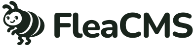

# ItsyWeb brand assets

These are the owner-approved ItsyWeb woven-loop mark and outlined wordmark,
imported from the Flea Website project's `t3/reframe-flea-html-focus` worktree.
`itsyweb-production.json` retains the approved artwork's conversion settings.
The full lockup has a 1363 × 298 viewBox. Preserve its contours and proportions;
body typography remains independent.

- `logo.svg` and `logo-light.svg`: full lockups for light and dark surfaces.
- `mark.svg`: the standalone woven-loop mark.
- `favicon.svg`, `favicon-32.png`, `apple-touch-icon.png`, `favicon.ico`: the
  approved website's browser and touch exports, copied without modification.

The starter and embedded development diagnostic use these assets. Existing
customer layouts, logos, icons and content are preserved by executable updates.
The public website is maintained in its separate repository.

The older mascot source, Nunito license, export.py/export.json and 16/192/512px
raster files remain as historical Flea provenance. They do not generate the
ItsyWeb assets; do not run the historical exporter over the current masters.
